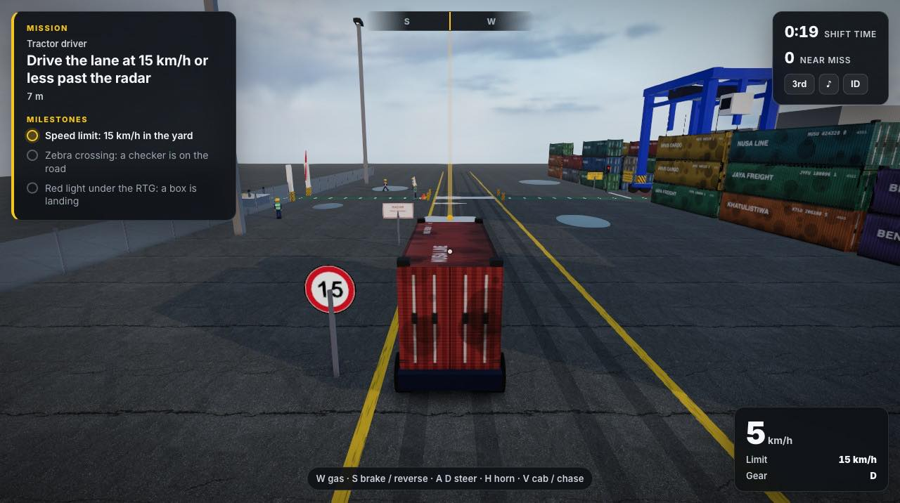
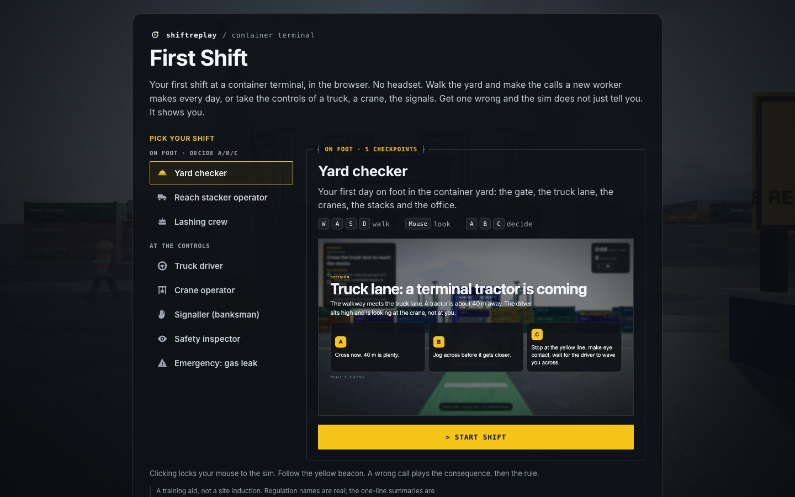
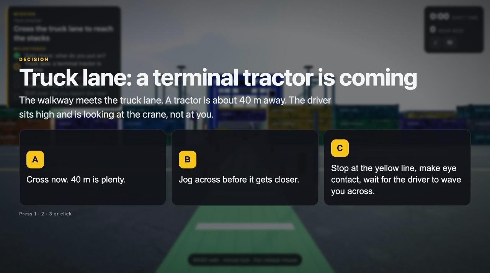
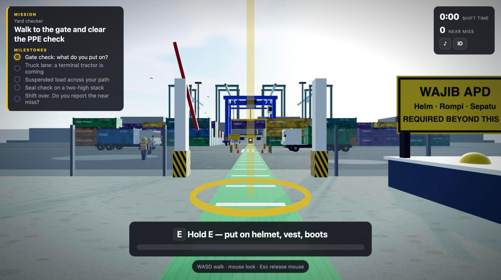
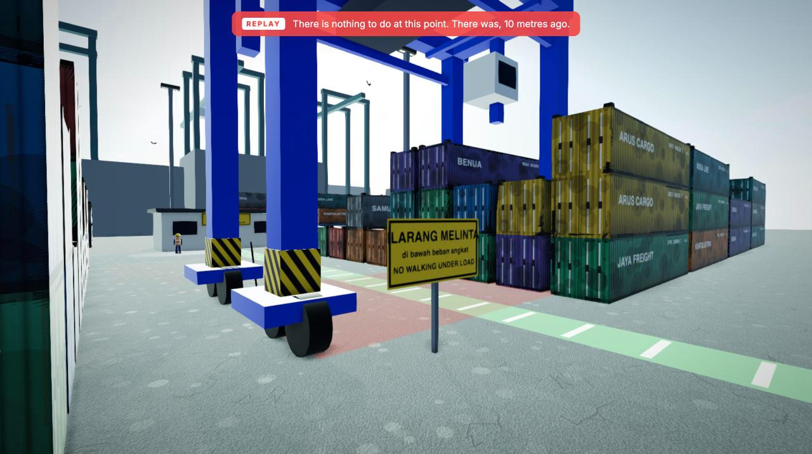
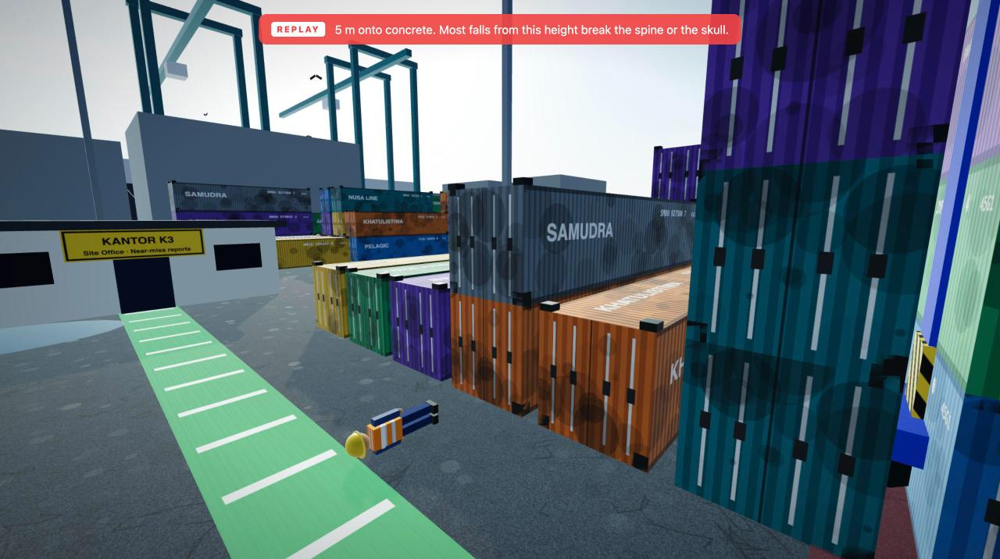
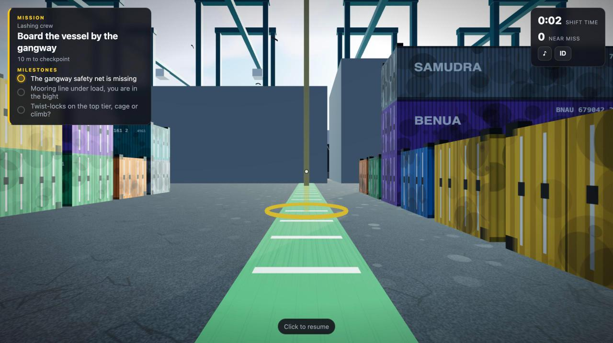
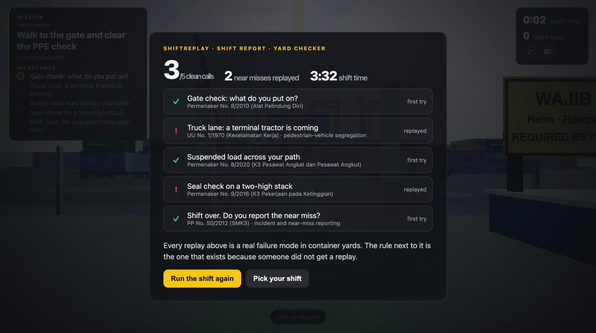
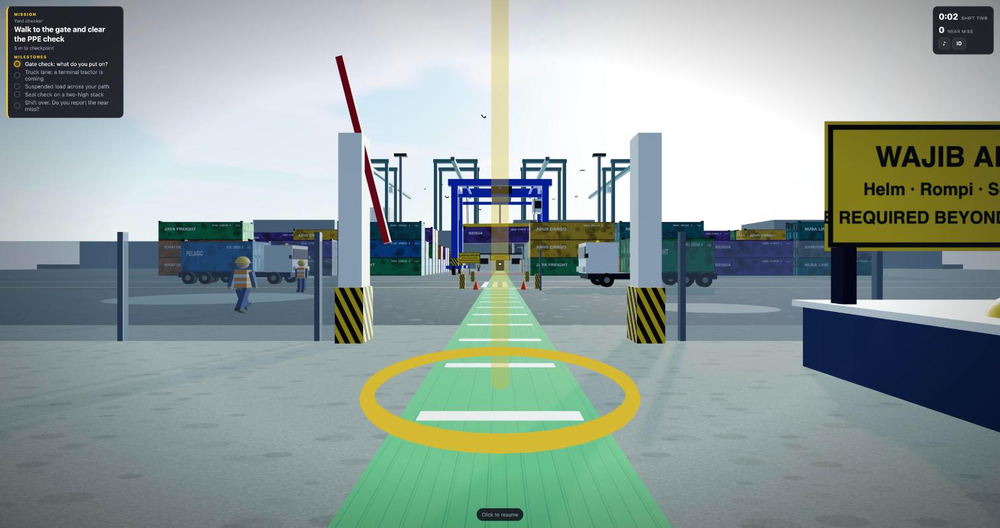
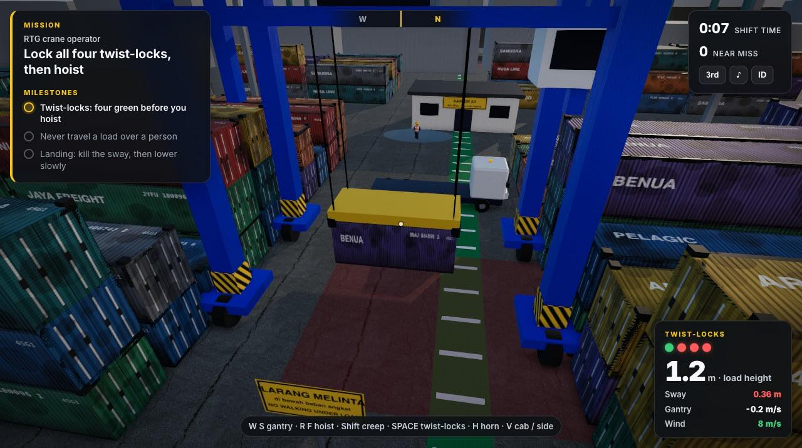

<p align="center">
  
</p>

<p align="center"><picture><source media="(prefers-color-scheme: dark)" srcset="public/mark-dark.svg" /></picture></p>
<h1 align="center">shiftreplay</h1>
<p align="center"><b>See the accident before it happens.</b><br>
Browser-only 3D safety training (K3) for ports and yards. Make the call, watch the consequence replay, learn the rule. No headset, no account, no server.</p>

<p align="center">
  <a href="https://shiftreplay.pages.dev"></a>
  
  
  
  
  
  
</p>

<p align="center">
  <a href="https://shiftreplay.pages.dev/play/"><b>Play</b></a> ·
  <a href="https://shiftreplay.pages.dev"><b>Landing</b></a> ·
  <a href="#demo-video"><b>Demo video</b></a> ·
  <a href="devpost/scope.md"><b>Scope</b></a> ·
  <a href="devpost/prd.md"><b>PRD</b></a> ·
  <a href="devpost/spec.md"><b>Spec</b></a> ·
  <a href="docs/ARCHITECTURE.md"><b>Architecture</b></a>
</p>

> Built for the **Build With AI: Basics** hackathon (Devpost Learn, Oct 2026) with Claude Code. Proof of concept, not certified training. See [Limitations](#known-limitations).
>
> **Testing:** open [shiftreplay.pages.dev/play](https://shiftreplay.pages.dev/play/) in a desktop browser (Chrome, Edge, Firefox or Safari) with a keyboard and mouse. No login, no install, no API key. Phones and tablets get a notice instead of the sim; `?force=1` skips it.

## Contents
- [Overview](#overview)
- [Why this matters](#why-this-matters)
- [The kernel](#the-kernel)
- [Product tour](#product-tour)
- [Three roles, eleven checkpoints](#three-roles-eleven-checkpoints)
- [Hands-on modes](#hands-on-modes)
- [Screens](#screens)
- [Quick start](#quick-start)
- [Recording and debug helpers](#recording-and-debug-helpers)
- [Architecture](#architecture)
- [Adding a checkpoint or a scene](#adding-a-checkpoint-or-a-scene)
- [How it was built](#how-it-was-built)
  - [AI assistance](#ai-assistance)
- [Third-party work](#third-party-work)
- [Known limitations](#known-limitations)
- [Documentation](#documentation)
- [Team](#team)
- [License](#license)

## Overview

Safety induction at Indonesian ports, plants and mines is mostly a slideshow and a signature. Companies such as [Molca](https://www.molca.id/) run VR safety patrols for terminals like Pelindo. It works, but it needs headsets, a vendor and a training room.

ShiftReplay is the version for everyone who does not get a headset. It is one web page: a container terminal rendered with three.js, a first-person walk, and the decisions a new worker meets on a first shift. Geometry and sound are generated in code; the sky and ground surfaces are CC0 files from Poly Haven. The sim has one runtime dependency, three.js.

| | |
|---|---|
| **Who it is for** | A new checker, operator or lasher on day one, and the HSE lead who has to induct them by Monday |
| **What it teaches** | Six Indonesian regulations (Permenaker 5/2018, 8/2010, 8/2020, 9/2016; UU 1/1970; PP 50/2012) through eleven decisions on foot and five hands-on modes |
| **What makes it different** | A wrong call is answered with a slow-motion replay of the accident, not a red X |
| **Runs on** | Any desktop browser with WebGL. No install, login, API key or server. Phones and browsers without WebGL see an explanation, not a black screen |

## Why this matters

| | Figure | Source |
|---|---|---|
| Work-accident cases in Indonesia, 2024 | **462,241** | Kemnaker on [data.go.id](https://data.go.id/dataset/dataset/kasus-kecelakaan-kerja-tahun-2024) |
| Same, 2022 | **298,137** (2024 is 55% higher) | Manpower Minister, Bulan K3 2025, via [Kontan](https://nasional.kontan.co.id/news/menteri-ketenagakerjaan-soroti-tren-peningkatan-jumlah-kecelakaan-kerja) |
| JKK accident-insurance claims, 2019 → 2022 | 182,835 → 297,725 | [BPJS Ketenagakerjaan](https://www.bpjsketenagakerjaan.go.id/berita/28681/KecelakaanKerja-Makin-Marak-dalam-Lima-Tahun-Terakhir) |
| Tanjung Perak, Surabaya, 2 Feb 2026 | Containers fell from a listing ship during cargo handling; one dockworker drowned | [CNN Indonesia](https://www.cnnindonesia.com/nasional/20260202193828-20-1323807/kapal-kontainer-oleng-di-surabaya-pekerja-ditemukan-tewas-tenggelam) |
| Tanjung Priok, 26 Sep 2024 | A container fell onto a truck cab; the driver died | [Akurat](https://www.akurat.co/hukum/763816/viral-satu-unit-truk-tertimpa-peti-kemas-di-pelabuhan-tanjung-priok-sopir-tewas) |
| Tanjung Priok, 9 Jul 2021 | A truck hit a container being unloaded; the driver died, the crane operator was named a suspect | [iNews](https://www.inews.id/news/megapolitan/sebabkan-sopir-truk-kontainer-tewas-di-pelabuhan-tanjung-priok-2-operator-ditetapkan-tersangka) |

The ILO's code of practice [*Safety and health in ports*](https://www.ilo.org/node/562891) (rev. 2016) still describes port work as an occupation with very high accident rates. A 2024 meta-analysis of 52 studies ([Scorgie et al., *Safety Science* 171](https://mro.massey.ac.nz/handle/10179/71203)) found immersive safety training outperformed traditional training on knowledge and retention; ShiftReplay asks how much of that a browser can deliver without a headset.

The port incidents above are the hazards the sim stages: a load coming down near people (`load`, crane operator, signaller), a vehicle and a person sharing a lane (`cross`, truck driver).

## The kernel

> When you make the wrong call, the sim does not say "incorrect". It cuts to a third-person replay of what would have happened to you (the truck, the dropped container, the fall), with the physics in the captions. Then, and only then, the rule.

Everything else in the repo exists to make that beat land: the walk builds presence, the big A/B/C decision makes the choice yours, the action step afterwards (hold **E** to clip in, hit **SPACE** when the driver waves) makes the safe behaviour physical, and the shift report tells you which lessons you needed a replay for.

## Product tour

1. **Pick a shift.** Three roles on foot (yard checker, reach stacker operator, lashing crew) or five hands-on modes. Pick from the list; the preview shows a screenshot, the keys and a start button.
2. **Walk.** WASD + mouse. The mission panel on the left lists milestones; a yellow beacon marks the next one. Trucks loop in the lane, the RTG sways, gulls circle the quay, diesel idles in the distance.
3. **Decide.** Reaching a checkpoint fills the screen with the situation and three options. Press **1 / 2 / 3** or **A / B / C**.
4. **Watch.** Wrong call → the camera cuts out of your body, the replay plays at 0.55×, the screen flashes at impact, and the captions tell you the speed, the mass and the stopping distance. Then the regulation. Choose again with that option struck out.
5. **Act.** Right call → an action step: hold **E** to put on PPE, do the walkaround, clip a harness, file the report; or time **SPACE** to the driver's wave or the winch easing.
6. **Report.** Clean calls out of N, near misses replayed, shift time, one row per checkpoint with the rule it cited.

## Three roles, eleven checkpoints

| Role | Checkpoint | Wrong call replays… | Regulation |
|---|---|---|---|
| Yard checker | Gate PPE | a twist-lock falling 11 m onto a bare head | Permenaker No. 8/2010 |
| Yard checker | Truck-lane crossing | a 25 t terminal tractor at the zebra | UU No. 1/1970 |
| Yard checker | Suspended load | the RTG's box dropping on the corridor | Permenaker No. 8/2020 |
| Yard checker | Seal check at height | a step off a wet container roof | Permenaker No. 9/2016 |
| Yard checker | Near-miss report | the same crossing, seven days later, a coworker | PP No. 50/2012 (SMK3) |
| Reach stacker operator | Pre-start on a warm machine | untested brakes meeting the walkway | Permenaker No. 8/2020 |
| Reach stacker operator | Checker in the blind spot | a pedestrian under a raised box | UU No. 1/1970 |
| Reach stacker operator | Stacking in 14 m/s gusts | an empty box leaving the spreader | Permenaker No. 8/2020 |
| Lashing crew | Gangway without a net | the gap between hull and quay | Permenaker No. 9/2016 |
| Lashing crew | Mooring line snap-back | a parted stern line | PP No. 50/2012 |
| Lashing crew | Top-tier lashing | riding the spreader at 14 m | Permenaker No. 9/2016 |

Replays are reused across roles with different captions where the physics is the same. That is a feature of the data format, not a shortcut (see [Adding a checkpoint](#adding-a-checkpoint-or-a-scene)).

## Hands-on modes

Five more shifts where the controls are the decision. There is no A/B/C: you drive, lift, signal, inspect or evacuate, and a mistake replays **your own run**. Every hands-on mode records its state each frame; on an incident the last few seconds play back from outside at 0.55×, with the real numbers in the banner (speed, load height, sway, ppm), then the consequence finishes and the rule appears.

| Mode | You control | Wrong move replays… | Regulation |
|---|---|---|---|
| Truck driver | W/S throttle and brake, A/D steer, H horn | your approach to the radar with your stopping distance drawn next to the 15 km/h one; the checker on the zebra; the box landing on your cab under a red RTG light | Permenaker 8/2020, UU 1/1970 |
| Crane operator | W/S gantry, R/F hoist, Shift creep, SPACE twist-locks, H horn | hoisting on 3 of 4 locks; carrying 30 t over a checker who stepped out between stacks; landing too fast or off the chassis | Permenaker 8/2020 |
| Signaller (banksman) | hold 1/4/2/3 to signal travel/away/lower/raise, SPACE all-stop, F wave someone off | signalling from inside the load path; not stopping for someone in the corridor; lowering with the driver beside the chassis | Permenaker 8/2020 |
| Safety inspector | walk, look, F to flag; 90 s | every hazard you missed plays its consequence before the report (one decoy costs 5 s) | Permenaker 8/2010, 8/2020, 9/2016; UU 1/1970; PP 50/2012 |
| Emergency: gas leak | walk; read the windsock; one A/B/C call | walking with the wind into the ammonia plume; running in to rescue; mustering at the downwind point | Permenaker 5/2018 (NAB 25 ppm), PP 50/2012 |

The crane and signaller modes share one RTG model (`src/modes/cranesim.js`): gantry travel, hoist, a pendulum load driven by gantry acceleration and wind, twist-locks that only turn when the box is seated. The gas plume is a pure function of time, so its replay is rebuilt exactly.

## Screens

| | |
|---|---|
|  <br> **Pick a shift** |  <br> **The yard, first person** |
|  <br> **Big A/B/C decision** |  <br> **Action step: hold E** |
|  <br> **Replay: suspended load** |  <br> **Replay: fall from the stack** |
|  <br> **Quay, STS cranes, the vessel** |  <br> **Shift report** |

## Quick start

Requires Node 20+ and [pnpm](https://pnpm.io) (npm 10.8 on Node 20 hits an arborist bug resolving Vite 8's peer set; pnpm resolves it cleanly).

```bash
git clone https://github.com/aarieffawwaz/basic-hackathon.git
cd basic-hackathon
pnpm install
pnpm dev          # landing at http://localhost:5173, sim at http://localhost:5173/play/
pnpm build        # static output in dist/ (landing + play)
pnpm preview      # smoke-test the build
```

Controls: **WASD / arrows** walk · **mouse** look · **V** first/third person · **Esc** release mouse · **click** re-lock · **1 2 3 / A B C** choose · **E** hold-actions · **SPACE** timing-actions · **♪** mute · **ID/EN** language.

## Recording and debug helpers

Query parameters on `/play/` so you can jump to any moment for a screenshot or the demo video:

| URL | Opens |
|---|---|
| `/play/?role=operator` | A role without the start screen (`checker`, `operator`, `lashing`, or a hands-on mode: `driver`, `crane`, `signal`, `inspect`, `evac`) |
| `/play/?at=2` | Checkpoint 2 of the role, decision open (hands-on modes: start at checkpoint 2) |
| `/play/?at=2&replay=1` | …and plays its first wrong option's replay (`replay=2.2` starts at t=2.2 s) |
| `/play/?at=1&action=1` | Checkpoint 1's action step |
| `/play/?end=1` | The shift report with sample results |
| `/play/?shot=1` | Skip the start screen, stand at spawn |
| `/play/?fx=0` | Disable post-processing (AO/SMAA) on weak GPUs |

See [docs/DEMO-GUIDE.md](docs/DEMO-GUIDE.md) for a shot list.

## Architecture

```
index.html ─── src/landing.js ──┐
                                 ├── src/world.js ── src/textures.js      (yard, sky, trucks, workers, birds; procedural textures)
play/index.html ── src/main.js ─┤
                                 ├── src/player.js                       (pointer-lock first person + AABB collision)
                                 ├── src/scenario.js                     (ROLES → hazards → options/actions/rules, EN+ID)
                                 ├── src/hazards.js                      (state machine: walk → prompt → replay → action → report)
                                 ├── src/replay.js                       (five scripted consequence scenes + caption overrides)
                                 ├── src/ui.js                           (mission panel, decision, action bar, report)
                                 ├── src/audio.js                        (WebAudio: wind, diesel, beeper, gulls, horn, impact, siren)
                                 └── src/modes/                          (hands-on modes: base, ghost replay, drive, crane, signal, inspect, evac)
```

| Piece | Responsibility |
|---|---|
| `world.js` | Builds the terminal from primitives; batches ~1,500 corner castings into one `InstancedMesh`; `Sky` + PMREM environment; returns colliders and an `update(dt)` |
| `boot.js` | Checks WebGL and the device before loading the sim; shows a notice instead of a black screen |
| `textures.js` | Canvas-drawn corrugation, grime, paint, hazard stripes and signs; also the fallback while the Poly Haven files in `public/tex/` load |
| `scenario.js` | Pure data. A role is `{ spawn, hazards[] }`; a hazard is `{ zone, objective, title, situation, options[3], action?, why, rule, captions? }` |
| `hazards.js` | The only state. `results[]` is `'pass' \| 'near'` per checkpoint; first-try tracking; action progress and timing windows |
| `replay.js` | `createReplayFor(id, world, lang, captions)` → `{ dur, cam(t), update(t), captions, impactAt, dispose }` |

Full description with the data model and failure modes: [docs/ARCHITECTURE.md](docs/ARCHITECTURE.md) and [devpost/spec.md](devpost/spec.md).

## Adding a checkpoint or a scene

A checkpoint is one object in `src/scenario.js`. To add one to the lashing role:

```js
{
  id: 'reefer',
  zone: { x: 0, z: -88, r: 2.8 },
  objective: { en: 'Plug in the reefer at bay 18', id: 'Colokkan reefer di bay 18' },
  title: { en: 'Reefer cable in a puddle', id: 'Kabel reefer di genangan' },
  situation: { en: '…', id: '…' },
  options: [
    { en: 'Plug it in, it is IP-rated.', id: '…', correct: false, replay: 'cross',
      captions: { en: ['…', '…', '…'], id: ['…', '…', '…'] } },   // reuse a replay, retell it
    { en: 'Isolate at the panel first.', id: '…', correct: true },
    { en: '…', id: '…', correct: false, replay: 'height' },
  ],
  action: { type: 'hold', key: 'KeyE', seconds: 1.5, label: { en: 'Hold E: isolate the panel', id: '…' } },
  why: { en: '…', id: '…' },
  rule: { name: 'Permenaker No. 12/2015 (K3 Listrik)', en: '…', id: '…' },
}
```

A new replay is a function in `src/replay.js` returning the same shape as the others (see `snapback`, 25 lines). A new scene is a new `world.js`. See [docs/HAZARD-FORMAT.md](docs/HAZARD-FORMAT.md).

## How it was built

Devpost Learn's workflow: **scope → PRD → spec → build → ship**, each a skill the coding agent runs. The planning files are the submission:

| Doc | What it holds |
|---|---|
| [`devpost/scope.md`](devpost/scope.md) | The kernel, who it is for, the core loop, what was cut and why |
| [`devpost/prd.md`](devpost/prd.md) | Core journey, screens, behaviour, product decisions |
| [`devpost/spec.md`](devpost/spec.md) | Stack, components, data model, failure modes, simplifications |
| [`devpost/checklist.md`](devpost/checklist.md) | Build slices with mechanical verification, revisions log |

### Iterations

The plan was approved before any code; everything after slice 3 came from playing the build and changing direction. Each change is logged under *Revisions* in [`devpost/checklist.md`](devpost/checklist.md).

| When (2026) | What changed | Why |
|---|---|---|
| Oct 23, 16:43 | First build: one role, five checkpoints, four scripted replays, EN/ID | Slices 1 to 3 of the approved plan |
| Oct 23, 17:21 | Three roles, hold-E / timing-SPACE actions, full-screen decisions, procedural sky and textures | After playing slice 3: "more than walking", bigger decisions, more interface |
| Oct 23, 17:55 | Ambient occlusion, SMAA, container frames, capsule-limbed workers; bloom tried and reverted | Feedback: "looks like Roblox". Bloom whited out the sky |
| Oct 23, 18:31 | Shadow camera follows the player and snaps to texels; a worker's face was on the back of his head | Shadows swam while walking |
| Oct 23, 18:36 | CC0 HDRI sky and PBR surfaces from Poly Haven | Procedural textures read as plastic up close |
| Oct 24, 19:36 | Five hands-on modes with own-run replay | Request to *be* the crane operator and the driver, not just watch them |
| Oct 24 | Loading bar, in-sim training disclaimer, device and WebGL checks; planning docs synced | Pre-submission review against what a first-time visitor sees |
| Oct 24 | Role picker became a list plus one preview; all checkpoint text rewritten in plain words | Feedback: the role cards were too much at once, and the explanations had too much port jargon |

Things that did not work the first time: npm 10.8 on Node 20 could not resolve Vite 8's peers (switched to pnpm); three r186 removed `PCFSoftShadowMap`; the first GPU render was overexposed (sun 2.4 → 1.7, exposure 0.95 → 0.72); headless Chrome could not render the scene in reasonable time, so verification moved to a real browser.

| First build (Oct 23, 16:43) | Now: crane operator, hands-on |
|---|---|
|  |  |

### AI assistance

ShiftReplay was built with [Claude Code](https://claude.com/claude-code) as the coding agent, driven by the Devpost Learn skill pack. What came from the AI and what came from us:

| The coding agent | The team |
|---|---|
| Interviewed us one question at a time (scope, PRD, spec) and wrote the planning docs from our answers | Picked the problem, the audience and the kernel; approved every planning doc before code |
| Wrote nearly all of the code in `src/`, including the procedural textures and WebAudio sound | Played every build and decided what changed: three roles, action steps, "looks like Roblox", the five hands-on modes, plain-language copy (see *Iterations*) |
| Ran the build and screenshot checks for each slice | Checked each slice in a real browser, chose and approved the CC0 assets, decided what was cut (VR, physics engine, model files) |
| Drafted the README and the submission write-up | Researched and sourced the accident figures, regulations and market (Molca); recorded and edited the demo video; edited and fact-checked the write-up |

The demo-video soundtrack was generated with Meta's MusicGen (see below). Nothing in the sim calls an AI service at runtime: no API key, no network dependency.

## Third-party work

Everything in `src/` was written for this hackathon with Claude Code during the submission period. Incorporated work from others:

| What | Where | License |
|---|---|---|
| [three.js](https://threejs.org) r186, including `RGBELoader` and the post-processing passes | runtime | MIT |
| [Vite](https://vite.dev) 8 | build | MIT |
| [ascii-magic-art](https://www.npmjs.com/package/ascii-magic-art): the dotted rules, block digits and player on the landing page | landing page | see package |
| [Poly Haven](https://polyhaven.com) HDRI `industrial_sunset_puresky` and PBR sets (`asphalt_02`, `concrete_floor_worn_001`, `corrugated_iron` and others in `public/tex/`) | sky, surfaces | CC0 |
| [Inter](https://rsms.me/inter/) via Google Fonts | landing page | OFL |
| Demo-video soundtrack generated with Meta's MusicGen; port ambience rendered from the sim's own `src/audio.js` | demo video | generated |
| Devpost Learn skill pack ([challengepost/learn-ai-basics](https://github.com/challengepost/learn-ai-basics)) | `.agents/skills/`, planning workflow | see repo |

Shipping-line names on the containers (NUSA LINE, PELAGIC, JAYA FREIGHT …) are invented. Regulation names are real Indonesian law; the one-line summaries are paraphrased.

### Demo video
_Link to be added at submission._

## Known limitations

| Today | Next |
|---|---|
| Regulation summaries are paraphrased, unreviewed | K3 practitioner review before any real induction use |
| Replays are scripted, fixed-camera | Camera shake and a closer angle if the lane replay does not make first-time viewers flinch |
| Desktop only (pointer lock, keyboard) | Touch controls |
| Third-person camera has no wall collision | Spring-arm raycast against colliders |
| One terminal scene | Petrochemical plant and mine haul road from the same hazard format |
| Procedural geometry; HDRI + 3 PBR sets | GLTF props (reach stacker, STS crane) behind the same `makeContainer` / `makeTruck` API |
| No persistence beyond language | Instructor view: which checkpoints a cohort gets wrong |

## Documentation

| File | |
|---|---|
| [docs/ARCHITECTURE.md](docs/ARCHITECTURE.md) | Modules, state machine, data model, render budget |
| [docs/HAZARD-FORMAT.md](docs/HAZARD-FORMAT.md) | Checkpoint / role / replay schema and how to extend |
| [docs/DEMO-GUIDE.md](docs/DEMO-GUIDE.md) | Shot list and URL helpers for the 1 to 3 min video |
| [docs/DEPLOY.md](docs/DEPLOY.md) | Cloudflare Pages and any static host |

## Team

| | Role |
|---|---|
| **Aarief Fawwaz** ([@aarieffawwaz](https://github.com/aarieffawwaz)) and **Alief Fauzan** ([@aliefauzan](https://github.com/aliefauzan)) | Scoping and planning with the skill pack, the sim (roles, replays, five hands-on modes, realism pass), plain-language copy and UX, Cloudflare deploy, README and submission, playtesting |
| **Umar Muhdhor** ([@umarmuhdhor](https://github.com/umarmuhdhor)) | Planning, accident data, regulation and market research, demo video, visuals, playtesting, QA and feedback |

## License

[MIT](LICENSE). Regulation names belong to the Republic of Indonesia; summaries are the author's paraphrase.
