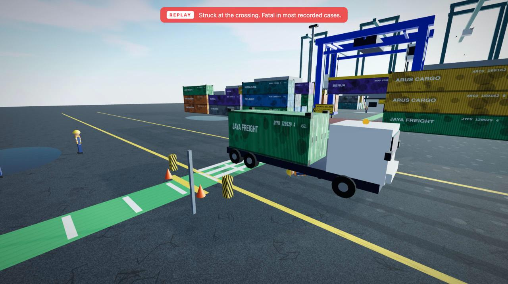

<p align="center">
  
</p>

<p align="center"></p>
<h1 align="center">ShiftReplay</h1>
<p align="center"><b>See the accident before it happens.</b><br>
Browser-only 3D safety training (K3) for ports and yards. Make the call, watch the consequence replay, learn the rule. No headset, no account, no server.</p>

<p align="center">
  <a href="https://shiftreplay.vercel.app"></a>
  
  
  
  
  
  
</p>

<p align="center">
  <a href="https://shiftreplay.vercel.app/play/"><b>Play</b></a> ·
  <a href="https://shiftreplay.vercel.app"><b>Landing</b></a> ·
  <a href="#demo-video"><b>Demo video</b></a> ·
  <a href="devpost/scope.md"><b>Scope</b></a> ·
  <a href="devpost/prd.md"><b>PRD</b></a> ·
  <a href="devpost/spec.md"><b>Spec</b></a> ·
  <a href="docs/ARCHITECTURE.md"><b>Architecture</b></a>
</p>

> Built for the **Build With AI: Basics** hackathon (Devpost Learn, Oct 2026) with Claude Code. Proof of concept, not certified training — see [Limitations](#known-limitations).

## Contents
- [Overview](#overview)
- [The kernel](#the-kernel)
- [Product tour](#product-tour)
- [Three roles, eleven checkpoints](#three-roles-eleven-checkpoints)
- [Screens](#screens)
- [Quick start](#quick-start)
- [Recording and debug helpers](#recording-and-debug-helpers)
- [Architecture](#architecture)
- [Adding a checkpoint or a scene](#adding-a-checkpoint-or-a-scene)
- [How it was built](#how-it-was-built)
- [Known limitations](#known-limitations)
- [Documentation](#documentation)
- [License](#license)

## Overview

Safety induction at Indonesian ports, plants and mines is mostly a slideshow and a signature. Companies such as [Molca](https://www.molca.id/) run VR safety patrols for terminals like Pelindo — effective, and gated behind headsets, a vendor and a training room.

ShiftReplay is the version for everyone who does not get a headset. It is one web page: a low-poly container terminal rendered with three.js, a first-person walk, and a set of decision checkpoints a new worker meets on a first shift. The scene, textures, sky and sound are all generated in code; the repository has a single runtime dependency.

| | |
|---|---|
| **Who it is for** | A new checker, operator or lasher on day one, and the HSE lead who has to induct them by Monday |
| **What it teaches** | Five Indonesian regulations (Permenaker 8/2010, 8/2020, 9/2016; UU 1/1970; PP 50/2012) through eleven decisions |
| **What makes it different** | A wrong call is answered with a slow-motion replay of the accident, not a red X |
| **Runs on** | Any desktop browser with WebGL. No install, login, API key or server |

## The kernel

> When you make the wrong call, the sim does not say "incorrect". It cuts to a third-person replay of what would have happened to you — the tractor, the dropped box, the fall — with the physics in the captions. Then, and only then, the rule.

Everything else in the repo exists to make that beat land: the walk builds presence, the big A/B/C decision makes the choice yours, the action step afterwards (hold **E** to clip in, hit **SPACE** when the driver waves) makes the safe behaviour physical, and the shift report tells you which lessons you needed a replay for.

## Product tour

1. **Pick a shift.** Yard checker (on foot), reach stacker operator (heavy equipment) or lashing crew (quay and vessel).
2. **Walk.** WASD + mouse. The mission panel on the left lists milestones; a yellow beacon marks the next one. Trucks loop in the lane, the RTG sways, gulls circle the quay, diesel idles in the distance.
3. **Decide.** Reaching a checkpoint fills the screen with the situation and three options. Press **1 / 2 / 3** or **A / B / C**.
4. **Watch.** Wrong call → the camera cuts out of your body, the replay plays at 0.55×, the screen flashes at impact, and the captions tell you the speed, the mass and the stopping distance. Then the regulation. Choose again with that option struck out.
5. **Act.** Right call → an action step: hold **E** to put on PPE, do the walkaround, clip a harness, file the report; or time **SPACE** to the driver's wave or the winch easing.
6. **Report.** Clean calls out of N, near misses replayed, shift time, one row per checkpoint with the rule it cited.

## Three roles, eleven checkpoints

| Role | Checkpoint | Wrong call replays… | Regulation |
|---|---|---|---|
| Yard checker | Gate PPE | a twist-lock falling 11 m onto a bare head | Permenaker No. 8/2010 |
| Yard checker | Truck-lane crossing | a 25 t terminal tractor at the zebra | UU No. 1/1970 |
| Yard checker | Suspended load | the RTG's box dropping on the corridor | Permenaker No. 8/2020 |
| Yard checker | Seal check at height | a step off a wet container roof | Permenaker No. 9/2016 |
| Yard checker | Near-miss report | the same crossing, seven days later, a coworker | PP No. 50/2012 (SMK3) |
| Reach stacker operator | Pre-start on a warm machine | untested brakes meeting the walkway | Permenaker No. 8/2020 |
| Reach stacker operator | Checker in the blind spot | a pedestrian under a raised box | UU No. 1/1970 |
| Reach stacker operator | Stacking in 14 m/s gusts | an empty box leaving the spreader | Permenaker No. 8/2020 |
| Lashing crew | Gangway without a net | the gap between hull and quay | Permenaker No. 9/2016 |
| Lashing crew | Mooring line snap-back | a parted stern line | PP No. 50/2012 |
| Lashing crew | Top-tier lashing | riding the spreader at 14 m | Permenaker No. 9/2016 |

Replays are reused across roles with different captions where the physics is the same — that is a feature of the data format, not a shortcut (see [Adding a checkpoint](#adding-a-checkpoint-or-a-scene)).

## Screens

| | |
|---|---|
|  <br> **Pick a shift** |  <br> **The yard, first person** |
|  <br> **Big A/B/C decision** |  <br> **Action step: hold E** |
|  <br> **Replay: suspended load** |  <br> **Replay: fall from the stack** |
|  <br> **Quay, STS cranes, the vessel** |  <br> **Shift report** |

## Quick start

Requires Node 20+ and [pnpm](https://pnpm.io) (npm 10.8 on Node 20 hits an arborist bug resolving Vite 8's peer set; pnpm resolves it cleanly).

```bash
git clone https://github.com/aarieffawwaz/basic-hackathon.git
cd basic-hackathon
pnpm install
pnpm dev          # landing at http://localhost:5173, sim at http://localhost:5173/play/
pnpm build        # static output in dist/ (landing + play)
pnpm preview      # smoke-test the build
```

| Script | What it does |
|---|---|
| `pnpm dev` | Vite dev server, HMR |
| `pnpm build` | Production build of both pages into `dist/` |
| `pnpm preview` | Serve `dist/` locally |

Controls: **WASD / arrows** walk · **mouse** look · **V** first/third person · **Esc** release mouse · **click** re-lock · **1 2 3 / A B C** choose · **E** hold-actions · **SPACE** timing-actions · **♪** mute · **ID/EN** language.

## Recording and debug helpers

Query parameters on `/play/` so you can jump to any moment for a screenshot or the demo video:

| URL | Opens |
|---|---|
| `/play/?role=operator` | A role without the start screen (`checker`, `operator`, `lashing`) |
| `/play/?at=2` | Checkpoint 2 of the role, decision open |
| `/play/?at=2&replay=1` | …and plays its first wrong option's replay (`replay=2.2` starts at t=2.2 s) |
| `/play/?at=1&action=1` | Checkpoint 1's action step |
| `/play/?end=1` | The shift report with sample results |
| `/play/?shot=1` | Skip the start screen, stand at spawn |
| `/play/?fx=0` | Disable post-processing (AO/SMAA) on weak GPUs |

See [docs/DEMO-GUIDE.md](docs/DEMO-GUIDE.md) for a shot list.

## Architecture

```
index.html ─── src/landing.js ──┐
                                 ├── src/world.js ── src/textures.js      (yard, sky, trucks, workers, birds; procedural textures)
play/index.html ── src/main.js ─┤
                                 ├── src/player.js                       (pointer-lock first person + AABB collision)
                                 ├── src/scenario.js                     (ROLES → hazards → options/actions/rules, EN+ID)
                                 ├── src/hazards.js                      (state machine: walk → prompt → replay → action → report)
                                 ├── src/replay.js                       (five scripted consequence scenes + caption overrides)
                                 ├── src/ui.js                           (mission panel, decision, action bar, report)
                                 └── src/audio.js                        (WebAudio: wind, diesel, beeper, gulls, horn, impact)
```

| Piece | Responsibility |
|---|---|
| `world.js` | Builds the terminal from primitives; batches ~1,500 corner castings into one `InstancedMesh`; `Sky` + PMREM environment; returns colliders and an `update(dt)` |
| `textures.js` | Canvas-drawn corrugation, bump, grime, asphalt, concrete, paint, hazard stripes, signs — no image files |
| `scenario.js` | Pure data. A role is `{ spawn, hazards[] }`; a hazard is `{ zone, objective, title, situation, options[3], action?, why, rule, captions? }` |
| `hazards.js` | The only state. `results[]` is `'pass' \| 'near'` per checkpoint; first-try tracking; action progress and timing windows |
| `replay.js` | `createReplayFor(id, world, lang, captions)` → `{ dur, cam(t), update(t), captions, impactAt, dispose }` |

Full description with the data model and failure modes: [docs/ARCHITECTURE.md](docs/ARCHITECTURE.md) and [devpost/spec.md](devpost/spec.md).

## Adding a checkpoint or a scene

A checkpoint is one object in `src/scenario.js`. To add one to the lashing role:

```js
{
  id: 'reefer',
  zone: { x: 0, z: -88, r: 2.8 },
  objective: { en: 'Plug in the reefer at bay 18', id: 'Colokkan reefer di bay 18' },
  title: { en: 'Reefer cable in a puddle', id: 'Kabel reefer di genangan' },
  situation: { en: '…', id: '…' },
  options: [
    { en: 'Plug it in, it is IP-rated.', id: '…', correct: false, replay: 'cross',
      captions: { en: ['…', '…', '…'], id: ['…', '…', '…'] } },   // reuse a replay, retell it
    { en: 'Isolate at the panel first.', id: '…', correct: true },
    { en: '…', id: '…', correct: false, replay: 'height' },
  ],
  action: { type: 'hold', key: 'KeyE', seconds: 1.5, label: { en: 'Hold E — isolate the panel', id: '…' } },
  why: { en: '…', id: '…' },
  rule: { name: 'Permenaker No. 12/2015 (K3 Listrik)', en: '…', id: '…' },
}
```

A new replay is a function in `src/replay.js` returning the same shape as the others (see `snapback`, 25 lines). A new scene is a new `world.js`. See [docs/HAZARD-FORMAT.md](docs/HAZARD-FORMAT.md).

## How it was built

Devpost Learn's workflow: **scope → PRD → spec → build → ship**, each a skill the coding agent runs. The planning files are the submission:

| Doc | What it holds |
|---|---|
| [`devpost/scope.md`](devpost/scope.md) | The kernel, who it is for, the core loop, what was cut and why |
| [`devpost/prd.md`](devpost/prd.md) | Core journey, screens, behaviour, product decisions |
| [`devpost/spec.md`](devpost/spec.md) | Stack, components, data model, failure modes, simplifications |
| [`devpost/checklist.md`](devpost/checklist.md) | Build slices with mechanical verification, revisions log |

Built with [Claude Code](https://claude.com/claude-code). Geometry, most textures, audio and copy are generated. The sky and three surface sets are CC0 from [Poly Haven](https://polyhaven.com): `industrial_sunset_puresky`, `asphalt_02`, `concrete_floor_worn_001`, `corrugated_iron` (1k, `public/tex/`).

### Demo video
_Link to be added at submission._

## Known limitations

| Today | Next |
|---|---|
| Regulation summaries are paraphrased, unreviewed | K3 practitioner review before any real induction use |
| Replays are scripted, fixed-camera | Camera shake and a closer angle if the lane replay does not make first-time viewers flinch |
| Desktop only (pointer lock, keyboard) | Touch controls |
| Third-person camera has no wall collision | Spring-arm raycast against colliders |
| One terminal scene | Petrochemical plant and mine haul road from the same hazard format |
| Procedural geometry; HDRI + 3 PBR sets | GLTF props (reach stacker, STS crane) behind the same `makeContainer` / `makeTruck` API |
| No persistence beyond language | Instructor view: which checkpoints a cohort gets wrong |

## Documentation

| File | |
|---|---|
| [docs/ARCHITECTURE.md](docs/ARCHITECTURE.md) | Modules, state machine, data model, render budget |
| [docs/HAZARD-FORMAT.md](docs/HAZARD-FORMAT.md) | Checkpoint / role / replay schema and how to extend |
| [docs/DEMO-GUIDE.md](docs/DEMO-GUIDE.md) | Shot list and URL helpers for the 1–3 min video |
| [docs/DEPLOY.md](docs/DEPLOY.md) | Vercel and any static host |

## License

[MIT](LICENSE). Regulation names belong to the Republic of Indonesia; summaries are the author's paraphrase.
